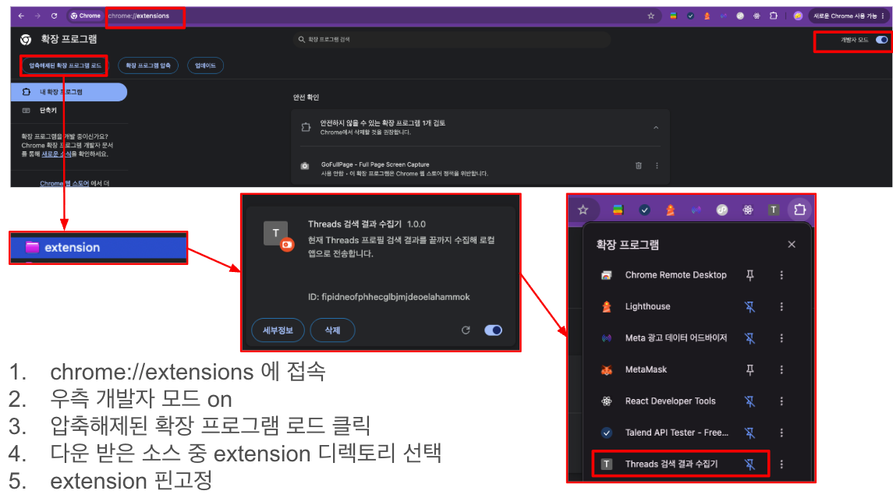
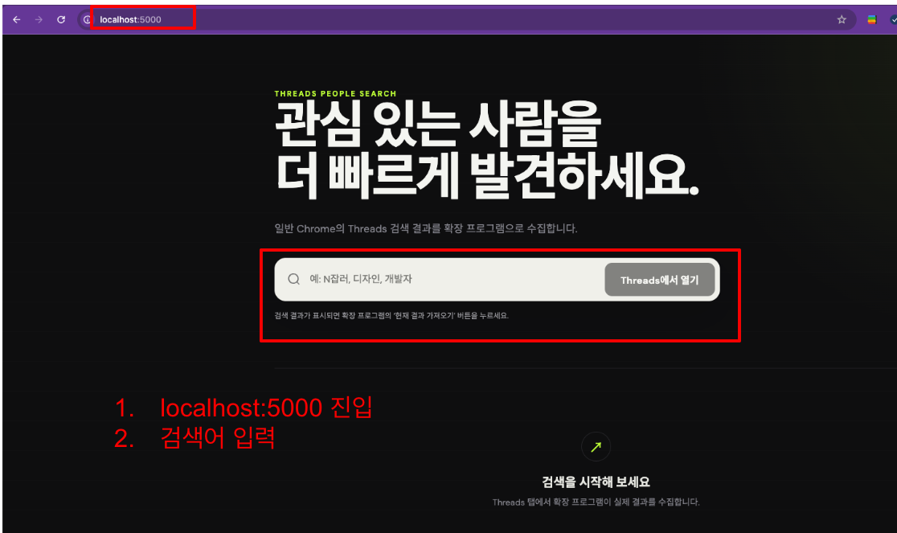
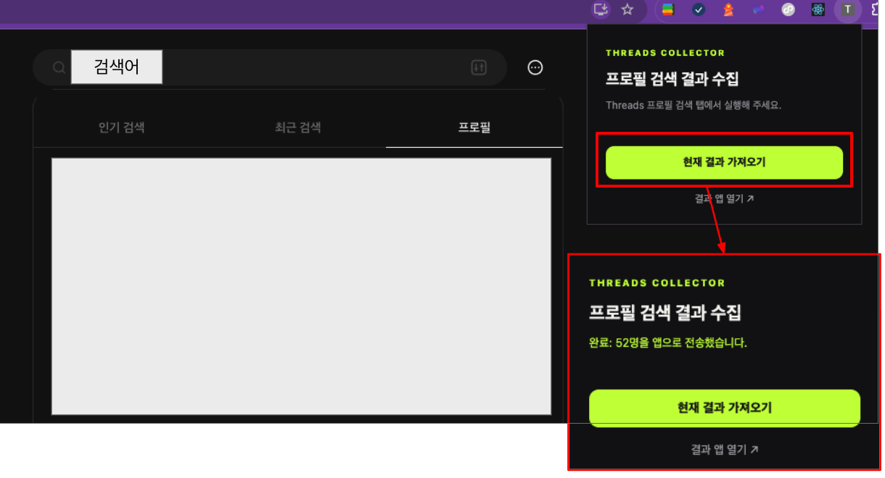
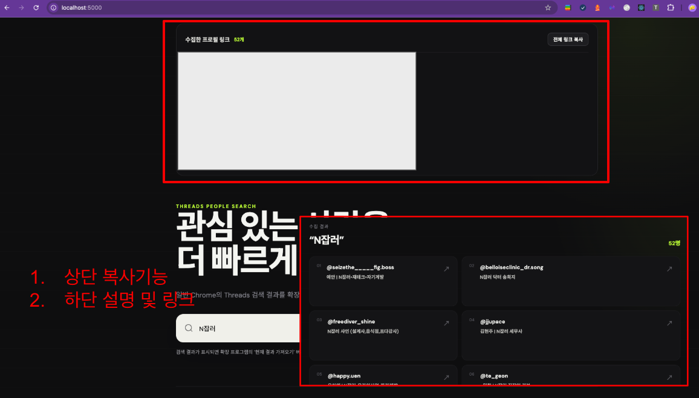
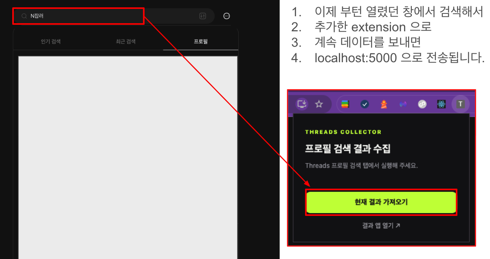

# Threads 프로필 검색 수집기

일반 Chrome에 이미 로그인된 Threads 세션을 그대로 사용합니다. Chrome 확장 프로그램이 현재 프로필 검색 화면에 렌더링된 결과를 즉시 읽고, 사용자명·표시 이름·소개·팔로워 수·인증 여부를 로컬 Next.js 앱으로 전송합니다. 이미지와 로그인 정보는 수집하지 않습니다.

## 1. 앱 실행

```bash
docker compose up --build -d
```

<http://localhost:5000>을 엽니다. 외부 노출 포트는 5000 하나이며 현재 컴퓨터에서만 접근할 수 있습니다.

## 2. Chrome 확장 프로그램 설치

1. Chrome 주소창에 `chrome://extensions`를 입력합니다.
2. 오른쪽 위 **개발자 모드**를 켭니다.
3. **압축해제된 확장 프로그램을 로드합니다**를 누릅니다.
4. 이 프로젝트의 `extension` 폴더를 선택합니다.
5. Chrome 도구 모음에서 `Threads 검색 결과 수집기`를 고정하면 편리합니다.



확장 프로그램은 Chrome 웹 스토어를 거치지 않은 로컬 개발용입니다. 아이디, 비밀번호, 쿠키는 읽거나 전송하지 않습니다.

## 3. 검색 및 수집

### Step 2. 앱에서 검색

1. <http://localhost:5000>에 접속합니다.
2. 검색어를 입력하고 **Threads에서 열기**를 누릅니다.
3. 평소 사용하는 Chrome의 로그인된 Threads 검색 탭이 열립니다.



### Step 3. 현재 검색 결과 가져오기

1. Threads 검색 결과가 표시되면 Chrome 도구 모음의 확장 프로그램 아이콘을 누릅니다.
2. `Threads 검색 결과 수집기`에서 **현재 결과 가져오기**를 누릅니다.
3. `완료: N명을 앱으로 전송했습니다`라는 메시지를 확인합니다.



### Step 4. 결과 확인 및 링크 복사

앱 탭으로 돌아오면 결과가 자동으로 표시됩니다. 화면 최상단에는 수집된 Threads 프로필 주소가 한 줄에 하나씩 나오며, 아래에는 계정별 상세 정보가 표시됩니다.

**전체 링크 복사** 버튼을 누르면 모든 프로필 주소가 줄바꿈된 텍스트로 클립보드에 복사됩니다.



### Step 5. 다른 검색어 계속 수집하기

이미 열려 있는 Threads 검색 탭에서 다른 검색어로 검색한 다음, 확장 프로그램의 **현재 결과 가져오기**를 다시 누르면 새 결과가 <http://localhost:5000>으로 전송됩니다.



현재 화면의 결과 DOM을 한 번만 읽기 때문에 보통 즉시 완료됩니다.

## 검색 결과 초기화

수집한 검색 결과는 브라우저가 아니라 Next.js 서버 메모리에 저장됩니다. 따라서 브라우저 탭이나 Chrome을 닫아도 결과가 계속 표시됩니다.

Docker로 실행 중이라면 다음 명령으로 컨테이너를 재시작해 검색 결과를 초기화할 수 있습니다.

```bash
docker compose restart
```

다음 경우에도 저장된 결과가 초기화됩니다.

- `docker compose down` 후 다시 실행
- Docker 컨테이너 재시작
- Docker 없이 사용 중이라면 Next.js 개발 서버 재시작

검색 결과는 데이터베이스나 파일에 영구 저장되는 것이 아니므로 서버가 재시작되면 복구할 수 없습니다.

## Windows

1. Docker Desktop for Windows를 설치하고 WSL 2 엔진을 활성화합니다.
2. PowerShell에서 프로젝트 폴더로 이동해 앱을 실행합니다.

```powershell
cd C:\path\to\search-thread
docker compose up --build -d
```

3. `chrome://extensions`에서 프로젝트의 `extension` 폴더를 로드합니다.
4. <http://localhost:5000>에서 사용합니다.

로그 확인과 종료:

```powershell
docker compose logs -f
docker compose down
```

## macOS

1. Apple Silicon 또는 Intel Mac에 맞는 Docker Desktop을 설치합니다.
2. Terminal에서 프로젝트 폴더로 이동해 앱을 실행합니다.

```bash
cd /path/to/search-thread
docker compose up --build -d
```

3. `chrome://extensions`에서 프로젝트의 `extension` 폴더를 로드합니다.
4. <http://localhost:5000>에서 사용합니다.

로그 확인과 종료:

```bash
docker compose logs -f
docker compose down
```

## Docker 없이 실행

Node.js 20 이상에서 실행할 수 있습니다.

```bash
npm install
npm run dev
```

이 경우 앱 주소는 <http://localhost:3000>입니다. 확장 프로그램의 전송 주소는 기본적으로 5000이므로 Docker 없이 사용할 때는 `extension/popup.js`의 API 주소를 `http://localhost:3000/api/results`로 변경해야 합니다.

## 문제 해결

- 확장 프로그램이 현재 탭을 찾지 못하면 `https://www.threads.com/search` 탭에서 다시 실행합니다.
- Threads 페이지를 이미 열어둔 상태에서 확장 프로그램을 처음 설치했다면 페이지를 한 번 새로고침합니다.
- 앱 전송 오류가 발생하면 <http://localhost:5000>이 열리는지 확인합니다.
- 확장 프로그램 코드를 수정한 경우 `chrome://extensions`에서 새로고침 버튼을 누릅니다.
- 결과가 0명이면 Threads 검색 탭이 `filter=profiles` 상태이며 실제 프로필 결과가 표시되는지 확인합니다.

## 주의 사항

- 짧은 시간에 반복 수집하면 Meta에서 요청을 제한할 수 있습니다.
- Threads 화면 구조가 변경되면 `extension/content.js`의 결과 선택자 수정이 필요할 수 있습니다.
- 서비스 운영 전 Threads 이용약관과 개인정보 관련 요건을 확인하세요.

## 이용 제한 및 면책 고지

이 프로젝트는 상업적 판매나 유료 서비스 제공을 목적으로 하지 않으며, **개인적인 마케팅 조사 및 업무 보조 용도로만** 사용해야 합니다.

- 수집한 정보를 광고성 메시지 발송, 스팸, 사칭, 괴롭힘, 개인정보 침해 또는 기타 불법적인 목적으로 사용하지 마세요.
- Threads 및 Meta의 이용약관, 개인정보처리방침, robots 정책과 사용 지역의 관련 법령을 반드시 준수하세요.
- 계정 정보 및 검색 결과를 수집·저장·가공·이용할 적법한 권한과 근거가 있는지 사용자가 직접 확인해야 합니다.
- 자동화된 반복 요청으로 서비스에 부하를 주거나 접근 제한을 우회하는 용도로 사용하지 마세요.

이 소프트웨어는 어떠한 보증 없이 현 상태 그대로 제공됩니다. 프로젝트 작성자 및 기여자는 사용자의 이용 방식, 약관 위반, 계정 제한, 데이터 손실, 개인정보 침해 또는 그 밖의 법적 분쟁과 손해에 대해 책임을 지지 않습니다. 이 프로젝트를 사용함으로써 발생하는 모든 책임과 위험은 사용자 본인에게 있습니다.

단, 본 면책 고지가 적용되는 범위는 관련 법률이 허용하는 범위로 제한됩니다.
